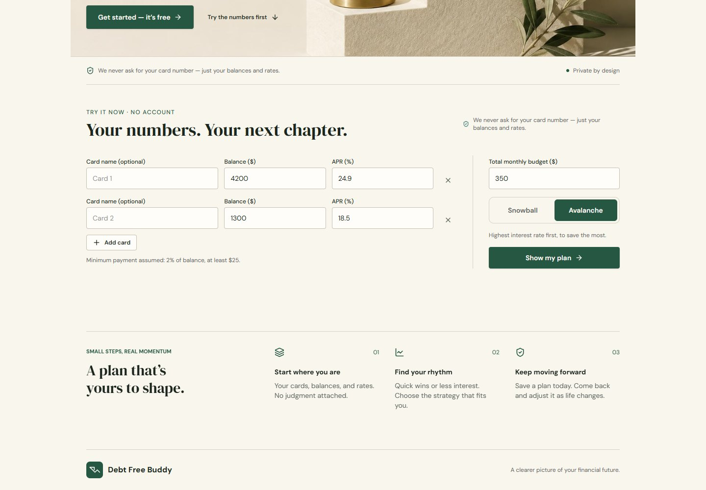
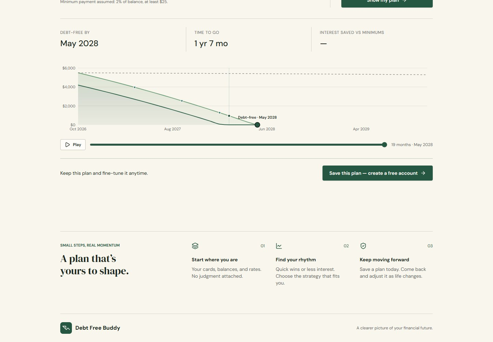
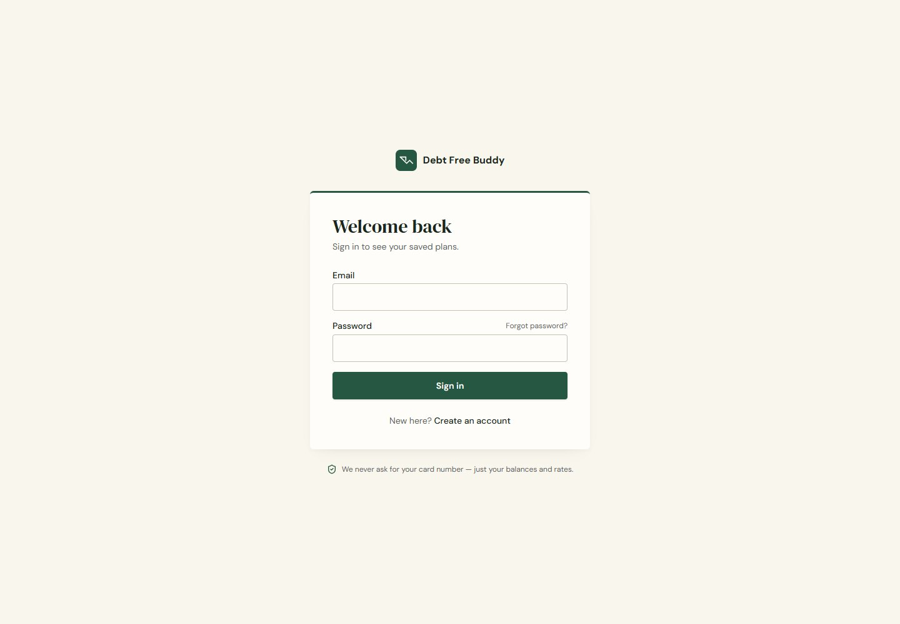
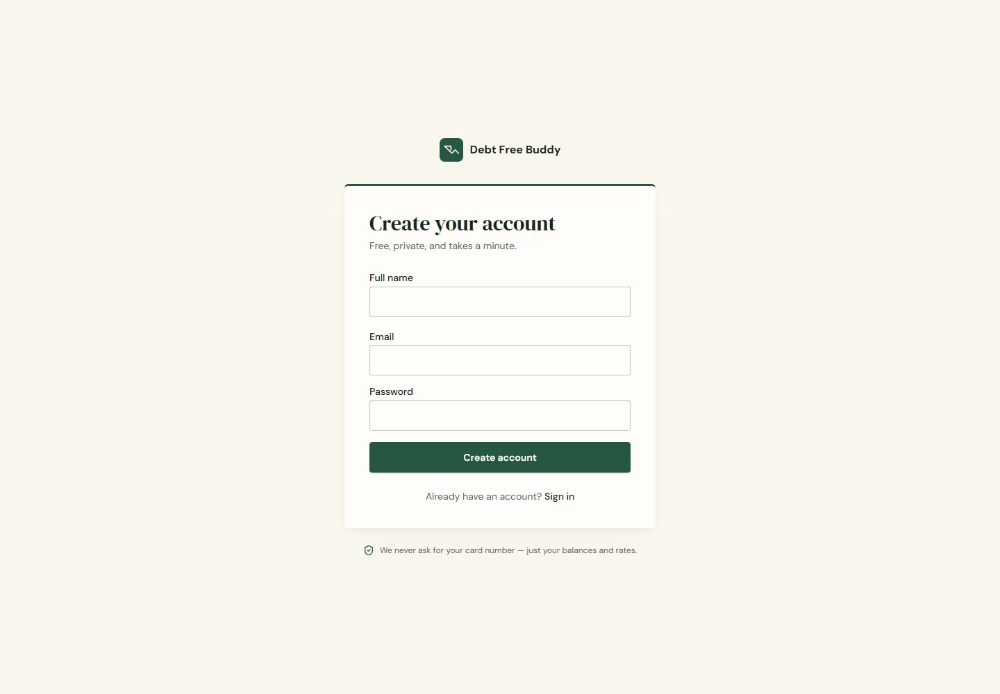

# Debt Free Buddy

Debt Free Buddy helps people turn credit-card debt into a clear, manageable payoff plan. Compare payoff strategies, save plans for different scenarios, and track real repayments alongside the original simulation.

> Debt Free Buddy does not connect to bank accounts or collect card numbers. Plans use the balances, interest rates, and budgets that you enter.

## Website screenshots

Captured locally from the current repository version, rather than the older published demo. The guest calculator uses the app's built-in example balances; no personal financial records are shown.


| Guest payoff calculator | Example payoff plan and chart |
|---|---|
|  |  |

| Sign in | Create an account |
|---|---|
|  |  |

<details>
<summary>Mobile preview</summary>


</details>

## What it does

- **Explore payoff plans:** Add debts and a monthly budget, then simulate Snowball or Avalanche repayment strategies.
- **Compare outcomes:** Review projected payoff timelines, interest costs, monthly balances, and strategy comparisons.
- **Save scenarios:** Keep multiple plans in your account and edit them later. Saved-card library items are copied into a scenario, so editing a library card does not change existing plans.
- **Track actual repayments:** Record dated payments against a card in a specific scenario. Starting balances stay unchanged; remaining balances use the original balance minus recorded payments.
- **See progress:** View total repaid, remaining debt, repayment percentage, monthly totals, streaks, and derived achievement badges.
- **Protect history:** Payment requests use a database RPC, scenario/card ownership checks, and idempotent retries. Scenario edits preserve existing card IDs; removing a card with payment history is blocked rather than silently deleting that history.

## Technology

- React, TypeScript, and TanStack Start
- Vite, Tailwind CSS, and shared UI components built with Radix UI
- Supabase Auth and PostgreSQL with row-level security
- Recharts for payoff visualizations and Motion for interface animation
- PostgreSQL SQL migrations with Drizzle migration metadata

## Run locally

### Requirements

- Node.js and npm
- A Supabase project for authentication and persisted user data

Install dependencies and start the development server:

```sh
npm install
npm run dev
```

Configure the Supabase project variables in an ignored local environment file such as `.env.local`:

```text
VITE_SUPABASE_URL=<your Supabase project URL>
VITE_SUPABASE_PUBLISHABLE_KEY=<your Supabase publishable key>
```

Use a publishable client key only. Never put a service-role key or database password in browser-facing variables or commit credentials. The application does not apply database migrations when it starts.

## Available commands

```sh
npm run dev                 # Start the local development server
npm run build               # Build the production bundle
npm run preview             # Preview the built app locally
npm run test:repayment      # Run repayment calculation and retry tests
npm run lint                # Run ESLint across the repository
npm run format              # Format files with Prettier
npx tsc --noEmit            # Check TypeScript types
```

## Database and migration status

The repayment feature requires the database tables and RPCs defined in migrations 0003–0007. The Drizzle journal currently records the verified base migrations through 0002; later migrations are not recorded there. Migrations 0004 and 0005 in this repository are newly authored replacement drafts, not recovered copies of the earlier reviewed files. The current 0004/0005 drafts have **not** been validated against PostgreSQL.

Before applying database changes, review:

- [`docs/lovable-cloud-migration-runbook.md`](docs/lovable-cloud-migration-runbook.md)
- [`docs/migration-reconciliation-plan.md`](docs/migration-reconciliation-plan.md)
- [`docs/repayment-migration-security-review.md`](docs/repayment-migration-security-review.md)

Confirm the target database's migration history and the supported migration workflow first. Test the exact migration files, in order, against a disposable PostgreSQL/Supabase-compatible database. Application builds and unit tests do not verify SQL execution, RLS behavior, privileges, or concurrency.

## Security notes

- Authentication and user-owned data rely on Supabase Auth and database RLS.
- Real payment records are scoped to a user and scenario; simulated future payments are not recorded as actual repayments.
- Achievement badges are derived from actual recorded payments and are not represented as persisted achievements by the UI.
- Do not use a production or personal database for local migration tests. Use synthetic data in a disposable environment.

## Project

Debt Free Buddy is developed locally and in [Lovable](https://lovable.dev). The repository is the source for the application and its migration documentation.
